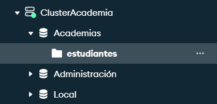
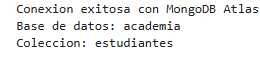
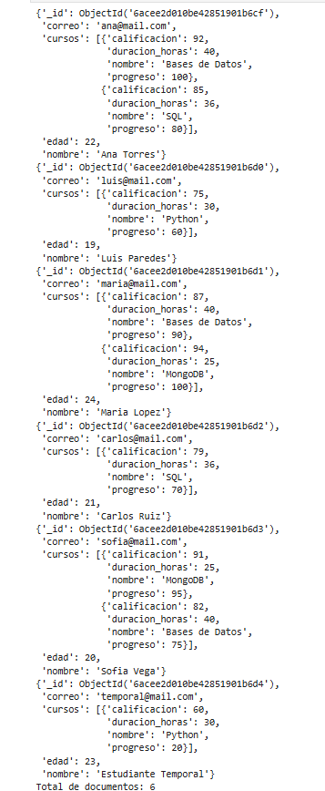

# Examen Práctico — MongoDB Atlas

## Bloque 2: Bases de Datos NoSQL

**Asignatura:** Base de Datos en la Nube  
**Estudiante:** [Tu nombre completo]  
**Fecha:** Octubre de 2026

## Descripción del proyecto

Este proyecto consiste en el diseño e implementación de una base de datos NoSQL para una academia de cursos en línea, utilizando MongoDB Atlas, Python y Jupyter Notebook.

El sistema permite almacenar información de estudiantes, cursos inscritos, calificaciones y progreso académico mediante documentos JSON/BSON.

Se utilizó una colección de estudiantes con arreglos y documentos anidados para representar la información académica.

## Objetivos

- Diseñar un modelo de documentos NoSQL.
- Crear una base de datos en MongoDB Atlas.
- Conectar Python con MongoDB mediante PyMongo.
- Insertar documentos de estudiantes con cursos anidados.
- Realizar diez consultas y operaciones NoSQL.
- Documentar el procedimiento mediante capturas de pantalla.

## Tecnologías utilizadas

| Tecnología | Descripción |
|---|---|
| MongoDB Atlas | Servicio de base de datos NoSQL en la nube. |
| MongoDB | Sistema de gestión de bases de datos orientado a documentos. |
| Python | Lenguaje utilizado para interactuar con MongoDB. |
| PyMongo | Librería de conexión y operaciones con MongoDB. |
| Jupyter Notebook | Entorno utilizado para ejecutar y documentar el código. |
| GitHub | Plataforma para presentar el proyecto y las evidencias. |

## Modelo NoSQL

Se creó una base de datos denominada `academia`, con una única colección llamada `estudiantes`.

Cada documento contiene información personal del estudiante y un arreglo de cursos. Los cursos incluyen su nombre, duración, calificación y progreso académico.

### Estructura de los documentos

El modelo utiliza los siguientes atributos:

| Campo | Tipo |
|---|---|
| _id | ObjectId |
| nombre | String |
| correo | String |
| edad | Integer |
| cursos | Array |
| cursos.nombre | String |
| cursos.duracion_horas | Integer |
| cursos.calificacion | Integer |
| cursos.progreso | Integer |

## Implementación en MongoDB Atlas

Se configuró un clúster de MongoDB Atlas y se creó la base de datos `academia` con la colección `estudiantes`.

Posteriormente se estableció una conexión mediante Python y la librería PyMongo desde Jupyter Notebook.

Se insertaron documentos de estudiantes con cursos anidados, cumpliendo el mínimo de cinco estudiantes solicitado en la actividad.

### Evidencia del clúster

### Base de datos y colección

### Conexión desde Jupyter Notebook

### Inserción de documentos

## Consultas NoSQL realizadas

Se desarrollaron las siguientes diez consultas y operaciones utilizando PyMongo:

1. **Todos los registros:** obtener todos los estudiantes mediante `find()`.
2. **Proyección:** mostrar únicamente nombres y correos electrónicos.
3. **Filtro por edad:** consultar estudiantes mayores de 20 años utilizando `$gt`.
4. **Filtro en arreglos:** buscar estudiantes inscritos en Bases de Datos.
5. **Consulta anidada:** encontrar estudiantes con calificaciones mayores o iguales a 80 utilizando `$gte`.
6. **Actualización con `$push`:** agregar un curso a un estudiante.
7. **Actualización con `$set`:** modificar la calificación de un curso.
8. **Eliminación:** eliminar un estudiante por correo electrónico mediante `delete_one()`.
9. **Conteo:** determinar cuántos estudiantes tienen más de un curso mediante `count_documents()`.
10. **Operador `$in`:** consultar estudiantes inscritos en SQL o MongoDB.

También se realizó una consulta complementaria utilizando `$and` y `$lt`.

## Evidencias de las consultas

| Consulta | Evidencia |
|---|---|
| Consulta 1 | [Ver captura](capturas/consulta_01.png) |
| Consulta 2 | [Ver captura](capturas/consulta_02.png) |
| Consulta 3 | [Ver captura](capturas/consulta_03.png) |
| Consulta 4 | [Ver captura](capturas/consulta_04.png) |
| Consulta 5 | [Ver captura](capturas/consulta_05.png) |
| Consulta 6 | [Ver captura](capturas/consulta_06.png) |
| Consulta 7 | [Ver captura](capturas/consulta_07.png) |
| Consulta 8 | [Ver captura](capturas/consulta_08.png) |
| Consulta 9 | [Ver captura](capturas/consulta_09.png) |
| Consulta 10 | [Ver captura](capturas/consulta_10.png) |

## Notebook del proyecto

El código completo se encuentra en el archivo:

[academia_mongodb.ipynb](academia_mongodb.ipynb)

Este Notebook contiene la conexión a MongoDB Atlas, la inserción de documentos y las diez consultas NoSQL.

## Instalación y ejecución

Para instalar las dependencias se puede utilizar:

`pip install -r requirements.txt`

Después se debe abrir Jupyter Notebook, ejecutar la celda de conexión e introducir las credenciales propias de MongoDB Atlas.

Las celdas de inserción, actualización y eliminación modifican la base de datos, por lo que deben ejecutarse únicamente cuando corresponda.

## Conclusiones

El desarrollo del Bloque 2 permitió comprender el funcionamiento de las bases de datos NoSQL orientadas a documentos.

MongoDB Atlas facilitó el almacenamiento de información académica en la nube, mientras que Python y PyMongo permitieron realizar consultas, inserciones, actualizaciones y eliminaciones de documentos.

El uso de arreglos y documentos anidados permitió representar la relación entre estudiantes y cursos sin utilizar múltiples tablas relacionales.

Finalmente, Jupyter Notebook facilitó la ejecución, comprobación y documentación de las operaciones NoSQL realizadas durante el examen.
